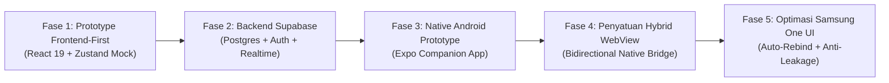
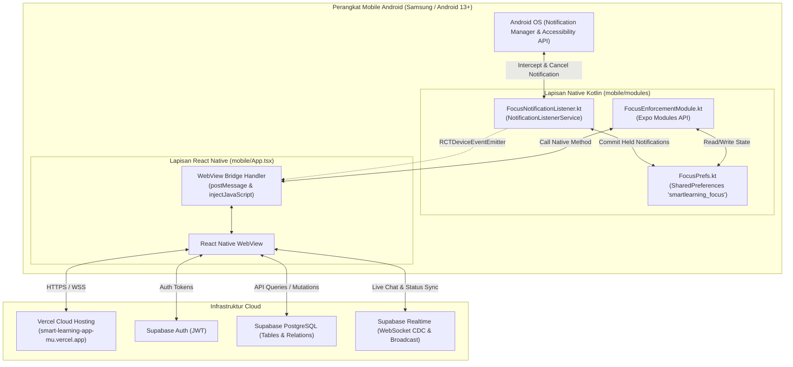
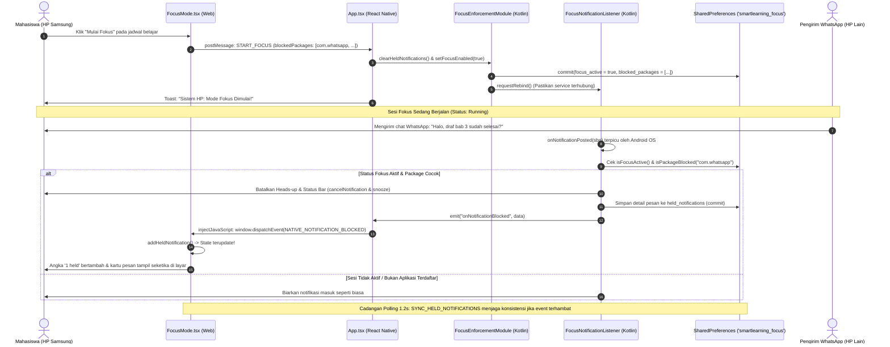
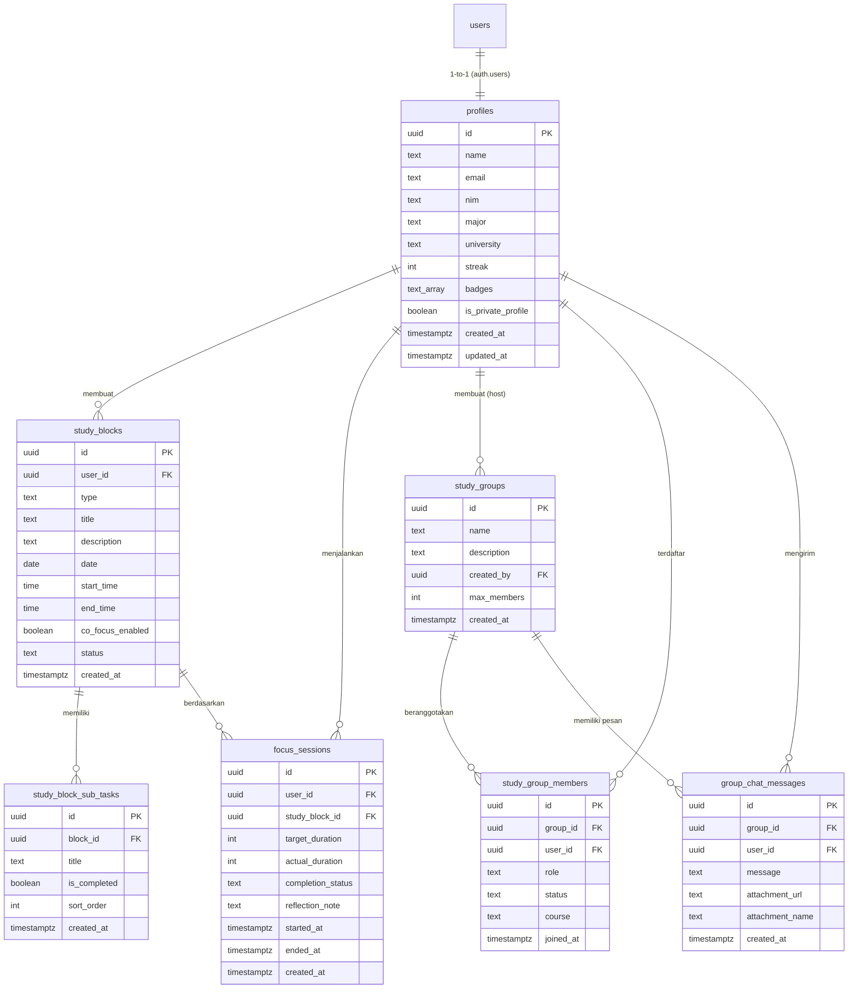

# DOKUMENTASI RANCANGAN & ARSITEKTUR SISTEM APLIKASI SMART FOCUS
**Sistem Manajemen Fokus Belajar Akademik & Kolaborasi Mahasiswa (SmartLearningApp)**  
*Dokumentasi Komprehensif: Evolusi Rancangan dari Prototype Awal hingga Produksi Terkini*  
*Versi Dokumen: 2.0 (November 2026)*  
*Repositori Resmi: `https://github.com/pratama034/SmartLearningApp.git`*  

---

## 1. Ringkasan Eksekutif & Identitas Proyek

### 1.1 Latar Belakang & Masalah
Mahasiswa sering menghadapi gangguan konsentrasi (*distraction*) yang parah saat belajar mandiri atau mengerjakan tugas akhir. Sumber distraksi terbesar berasal dari **smartphone**, terutama notifikasi pesan instan (WhatsApp, Telegram) dan media sosial (Instagram, TikTok, YouTube). Di sisi lain, belajar sendirian sering kali memicu rasa jenuh dan hilangnya akuntabilitas belajar (*lack of social accountability*).

### 1.2 Solusi: Smart Focus Akademik
**Smart Focus** adalah platform produktivitas akademik komprehensif yang memadukan tiga pilar utama:
1. **Perencanaan Blok Waktu Belajar (*Time Blocking & Sub-task Checklist*)**: Memungkinkan mahasiswa memecah jadwal ujian (UTS/UAS), pengerjaan tugas, dan skripsi ke dalam blok fokus terstruktur.
2. **Pencegah Distraksi Tingkat Sistem HP (*Native Android Focus Enforcement*)**: Membatalkan dan menahan notifikasi pesan instan/sosial media secara otomatis di tingkat sistem Android (Samsung One UI kompatibel) saat sesi fokus berjalan, serta mengumpulkannya di kartu *Notifikasi yang Ditunda* untuk direfleksikan setelah sesi usai.
3. **Ruang Belajar Bersama (*Real-time Co-Focus Group*)**: Memungkinkan mahasiswa belajar dalam grup virtual hingga 10 orang dengan pelacakan status fokus rekan secara *live* dan forum diskusi interaktif.

---

## 2. Peta Evolusi Rancangan (Prototype Awal ke Sistem Produksi)

Aplikasi ini berkembang melalui **5 fase perancangan sistem**:



### Fase 1: Prototype Frontend-First (Mock In-Memory + LocalStorage)
* **Karakteristik**: Single Page Application (SPA) berbasis **React 19**, **TypeScript**, dan **Vite 8**.
* **Manajemen State**: Zustand murni dengan persistensi lokal `localStorage`.
  * `authStore.ts`: Autentikasi pura-pura (*dummy user*) `Budi Santoso` (NIM: 2201082001).
  * `studyStore.ts`: Jadwal belajar *mock* untuk hari ini dan kalender mendatang.
  * `sessionStore.ts`: Timer hitung mundur (*countdown timer*) Pomodoro/Deep Focus lokal.
  * `groupStore.ts`: Simulasi ruang belajar bersama dengan status anggota *hardcoded*.
* **Sistem Desain**: Dibangun dengan **Tailwind CSS** mengadopsi tema *Classic Academic Clean*:
  * *Primary Navy* (`#1D3668`): Otoritas akademik dan tombol primer.
  * *Accent Crimson* (`#BE2257`): Penanda aksi penting dan label *eyebrow*.
  * *Canvas Light* (`#F3F4FA` / `#DFE4F1`): Latar belakang bersih dan garis batas lembut.

### Fase 2: Integrasi Backend Produksi Supabase Cloud
* **Transisi**: Mengganti data pura-pura menjadi database PostgreSQL di **Supabase Cloud**.
* **Fitur yang Diaktifkan**:
  * **Supabase Auth**: Registrasi dan login nyata dengan enkripsi kata sandi dan JWT session.
  * **Skema Relasional**: Tabel `profiles`, `study_blocks`, `study_block_sub_tasks`, `focus_sessions`, `study_groups`, `study_group_members`, dan `group_chat_messages`.
  * **Supabase Realtime (WebSocket CDC)**: Sinkronisasi pesan forum grup instan dan status anggota (`fokus` vs `istirahat`) tanpa perlu memuat ulang halaman (*zero polling*).
  * **Gamifikasi Belajar**: Kalkulasi *study streak* harian otomatis dan penetapan *badge* mahasiswa (Pemula Fokus, Konsisten Belajar, Penakluk Skripsi).

### Fase 3: Eksperimen Native Android (Companion App Prototype)
* **Tujuan**: Menguji kemampuan pemblokiran notifikasi dan penguncian aplikasi di tingkat OS Android menggunakan folder `mobile/` berbasis **Expo SDK 58 + React Native 0.88**.
* **Hasil Awal**: Dibuat 2 modul Android tingkat rendah (Kotlin):
  * `FocusAccessibilityService.kt`: Memanfaatkan Android Accessibility API untuk mengembalikan pengguna ke layar fokus jika membuka aplikasi terlarang (Instagram/TikTok).
  * `FocusNotificationListener.kt`: Memanfaatkan `NotificationListenerService` untuk menangkap notifikasi masuk.
* **Keterbatasan Awal**: Aplikasi `mobile/` terpisah dengan tema gelap (*dark theme*) dan tidak terhubung langsung ke web app produksi di Vercel.

### Fase 4: Penyatuan Arsitektur Menjadi Hybrid WebView Native Bridge
* **Inovasi Arsitektur**: Mengubah `mobile/App.tsx` menjadi **Hybrid Shell** yang memuat aplikasi web produksi (`https://smart-learning-app-mu.vercel.app/`) menggunakan `react-native-webview`.
* **Bidirectional Bridge Protocol**:
  * Halaman web mengirim perintah (`SET_BLOCKED_APPS`, `START_FOCUS`, `STOP_FOCUS`, `CHECK_PERMISSIONS`) melalui `window.ReactNativeWebView.postMessage()`.
  * React Native menangkap pesan tersebut, meneruskannya ke modul Kotlin native, dan menyuntikkan respons (`NATIVE_NOTIFICATION_BLOCKED`, `NATIVE_PERMISSIONS_STATUS`) kembali ke web via `webViewRef.injectJavaScript()`.

### Fase 5: Penguatan Sistem Operasi Android Khusus Samsung One UI & EAS Build
* **Tantangan Samsung**: Sistem operasi Samsung One UI (Android 13/14+) memiliki mekanisme agresif:
  1. *Restricted Settings*: Izin Akses Notifikasi diblokir otomatis untuk aplikasi yang diinstal di luar Play Store (*sideload APK*).
  2. *Silent Listener Disconnect*: Service listener ditutup paksa saat HP masuk mode hemat daya atau aplikasi di-*restart*.
  3. *Group Summaries Leakage*: WhatsApp mengirim pesan bergrup yang tetap memunculkan *heads-up banner*.
* **Solusi Akhir**:
  * Implementasi *Triple-Layer Notification Suppression* (`cancelNotification(key)`, `cancelNotification(pkg, tag, id)`, dan `snoozeNotification` 24 jam).
  * Implementasi *Auto-Rebind Service* via `onListenerDisconnected()` dan `requestRebind(ComponentName)` setiap kali sesi fokus dimulai.
  * Sinkronisasi data sinkron menggunakan `SharedPreferences.commit()` dan polling cadangan 1.2 detik ke memori native HP.
  * Isolasi sesi bersih: Jadwal yang telah selesai dinonaktifkan (*disabled*), dan memori notifikasi ditahan selalu di-reset ke 0 pada awal setiap sesi belajar baru.

---

## 3. Arsitektur Sistem & Diagram Alur

### 3.1 Diagram Arsitektur Keseluruhan


### 3.2 Alur Pemblokiran & Penahanan Notifikasi Realtime


---

## 4. Rincian Modul & Fitur Aplikasi

### 4.1 Modul Autentikasi & Profil (`src/pages/Auth.tsx`, `src/pages/Settings.tsx`)
* **Registrasi & Login**: Menggunakan Supabase Auth (`supabase.auth.signUp` & `signInWithPassword`) dengan pengisian data awal mahasiswa: Nama Lengkap, Email Kampus, NIM, Program Studi, dan Universitas.
* **Manajemen Profil (`authStore.ts`)**: Sinkronisasi profil mahasiswa secara dua arah dengan tabel `profiles` di Supabase.
* **Pengaturan Privasi & Gamifikasi**:
  * Switch privasi untuk menyembunyikan profil dari Leaderboard Kampus publik.
  * Tampilan *Streak Belajar* (beruntun harian) dan *Badges* pencapaian akademik.
* **Panel Izin Khusus Android Samsung**:
  * Indikator status realtime izin: *Izin Akses Notifikasi* dan *Izin Aksesibilitas*.
  * Tombol pintasan langsung membuka pengaturan sistem HP Android.
  * Tombol **"Baterai Tanpa Batas"** untuk membuka `ACTION_IGNORE_BATTERY_OPTIMIZATION_SETTINGS` agar Samsung tidak mematikan service di latar belakang.
  * Tombol **"Uji Simulasi Notifikasi"** untuk menguji apakah kartu penahan notifikasi di layar berfungsi seketika tanpa harus meminjam HP orang lain.

### 4.2 Modul Dashboard Akademik (`src/pages/Dashboard.tsx`)
* **Header Dinamis**: Sapaan ramah berbasis waktu lokal (Selamat pagi/siang/sore/malam), tanggal lengkap bahasa Indonesia, dan avatar monogram mahasiswa.
* **4 Stat Tiles Utama**:
  1. *Total Jam Fokus*: Akumulasi durasi fokus mahasiswa.
  2. *Streak Belajar*: Jumlah hari belajar berturut-turut dengan ikon api animasi.
  3. *Sesi Selesai*: Jumlah blok belajar yang sukses dirampungkan.
  4. *Notifikasi Ditahan*: Total gangguan notifikasi yang berhasil diredam selama sesi fokus.
* **Widget Realtime Co-Focus**: Menampilkan rekan satu kelompok belajar yang sedang berstatus 'fokus' secara langsung melalui Supabase Realtime Channel.
* **Daftar Jadwal Hari Ini**: Kartu interaktif untuk langsung membuka sesi fokus aktif atau memulai jadwal terjadwal.

### 4.3 Modul Perencanaan Jadwal Belajar (`src/pages/StudyBlocks.tsx`, `src/store/studyStore.ts`)
* **Struktur Data Study Block**:
  * `title`: Judul mata kuliah atau target tugas (misal: "Analisis Algoritma - Tugas 2").
  * `type`: Kategori blok (`UTS`, `UAS`, `Tugas`, `Kuliah`, `Praktikum`, `Skripsi`).
  * `date`: Tanggal target pelaksanaan (format `YYYY-MM-DD`).
  * `start_time` & `end_time`: Rentang waktu belajar (format `HH:mm`).
  * `status`: Status blok (`scheduled` / `completed`).
  * `co_focus_enabled`: Penanda apakah sesi ini disiarkan ke ruang belajar bersama.
  * `subTasks`: Daftar rincian checklist target capaian per sesi (contoh: "Baca bab 3", "Kerjakan soal 1-5").
* **Validasi Form**: Menggunakan validasi schema Zod untuk mencegah bentrok jam dan input kosong.

### 4.4 Modul Mode Fokus Mendalam (`src/pages/FocusMode.tsx`, `src/store/sessionStore.ts`)
* **Timer Hitung Mundur Presisi**: Menghitung mundur durasi berdasarkan selisih waktu `end_time` - `start_time` dengan fungsi `tick()` per detik, kontrol jeda (*pause*), dan lanjut (*resume*).
* **Checklist Target Sesi Dinamis**: Mahasiswa dapat mencentang sub-tugas yang telah selesai langsung di layar fokus; status tersinkronisasi otomatis ke Supabase `study_block_sub_tasks`.
* **Kolom Notifikasi yang Ditunda (*Held Notifications List*)**:
  * Menampilkan badge nama aplikasi (WhatsApp, Instagram, TikTok, dll.).
  * Menampilkan nama pengirim atau judul notifikasi.
  * Menampilkan isi pesan pesan chat yang dicegat.
  * Menampilkan stempel waktu tepat kapan pesan tersebut ditahan.
* **Aturan Proteksi Sesi**:
  * Blok belajar yang telah berstatus `completed` **dinonaktifkan secara permanen** dari tombol pemilihan sesi, mencegah duplikasi fokus.
  * Saat sesi baru dimulai, daftar notifikasi ditahan di-reset bersih ke 0 agar data sesi lama tidak tercampur.
  * Saat tombol "Mulai Fokus" ditekan, status anggota di tabel `study_group_members` otomatis berubah menjadi `fokus`.

### 4.5 Modul Ringkasan & Refleksi Sesi (`src/pages/SessionSummary.tsx`)
* **Rekapitulasi Metrik**: Menampilkan perbandingan durasi yang direncanakan (*target duration*) vs durasi aktual (*actual duration*), serta status penyelesaian (`completed` atau `ended_early`).
* **Audit Notifikasi Ditahan**: Daftar lengkap semua notifikasi yang berhasil dicegah selama mahasiswa belajar, memungkinkan mahasiswa membalas pesan penting setelah belajar selesai.
* **Formulir Catatan Refleksi**: Mahasiswa menuliskan catatan evaluasi belajar yang disimpan ke tabel database `focus_sessions` kolom `reflection_note`.
* **Efek Selebrasi**: Pemicu animasi *confetti* jika sesi berhasil diselesaikan sesuai target durasi.

### 4.6 Modul Ruang Belajar Bersama Co-Focus (`src/pages/CoFocus.tsx`, `StudyGroupRoom.tsx`)
* **Manajemen Kelompok**: Mahasiswa dapat membuat kelompok belajar baru (*host*) atau bergabung menggunakan ID grup. Batas kapasitas anggota hingga 10 mahasiswa.
* **Fitur Chat Realtime**:
  * Percakapan langsung antar anggota berbasis Supabase Realtime Channels (`postgres_changes` pada tabel `group_chat_messages`).
  * Dukungan unggah dan pratinjau lampiran berkas (PDF tugas, dokumen Word, gambar).
* **Live Presence Status**: Monogram avatar anggota dengan indikator warna status:
  * *Sedang Fokus* (Crimson Pill `#FCDDE6` / `#8E1744`): Rekan sedang dalam sesi hitung mundur fokus.
  * *Istirahat* (Cream Pill `#FDEBC8` / `#7A4B00`): Rekan sedang tidak dalam mode fokus.
* **Kontrol Admin Kelompok**: Host grup memiliki hak istimewa mengeluarkan anggota (*kick member*) dan membubarkan/menghapus kelompok belajar.

### 4.7 Modul Laporan & Analitik (`src/pages/Reports.tsx`)
* **Visualisasi Recharts**:
  * Grafik batang tren waktu fokus mingguan (*Weekly Focus Distribution*).
  * Grafik area capaian produktivitas harian.
* **Tab Laporan Pribadi vs Kampus**:
  * *Laporan Pribadi*: Analisis efektivitas belajar mandiri, rata-rata durasi sesi, dan rasio gangguan notifikasi yang ditekan.
  * *Laporan Kampus*: Papan peringkat mahasiswa dengan jam fokus tertinggi dalam 30 hari terakhir (menghormati pengaturan privasi pengguna).

---

## 5. Skema Basis Data PostgreSQL (Supabase)

Berikut adalah cetak biru skema database relasional di Supabase yang mendukung seluruh fitur aplikasi:



---

## 6. Arsitektur Modul Native Android (`mobile/`)

Folder `mobile/` adalah aplikasi **React Native (Expo SDK 58)** yang dikonfigurasi secara khusus untuk berinteraksi dengan kernel Android melalui modul Kotlin native:

### 6.1 `FocusNotificationListener.kt` (Pencegat Notifikasi)
* **Kelas Induk**: `android.service.notification.NotificationListenerService`.
* **Izin Manifest**: `android.permission.BIND_NOTIFICATION_LISTENER_SERVICE`.
* **Fungsi Utama**:
  1. `onListenerConnected()` & `onListenerDisconnected()`: Memantau ikatan layanan ke Android OS. Jika terputus oleh manajemen daya Samsung, otomatis mengeksekusi `requestRebind(ComponentName)` untuk menyambungkan diri kembali.
  2. `onNotificationPosted(sbn: StatusBarNotification)`:
     * Memeriksa apakah sesi fokus aktif (`FocusPrefs.isFocusActive(context)`).
     * Memeriksa apakah nama paket aplikasi cocok dengan daftar blokir (`isPackageBlocked`).
     * Jika cocok, langsung memanggil:
       * `cancelNotification(sbn.key)` (membatalkan notifikasi spesifik).
       * `cancelNotification(sbn.packageName, sbn.tag, sbn.id)` (membatalkan via 3-tuple Android).
       * `snoozeNotification(sbn.key, 24 jam)` (meredam heads-up banner secara tuntas).
     * Mengekstrak informasi pengirim dan teks pesan dari `sbn.notification.extras` (`EXTRA_TITLE`, `EXTRA_TEXT`, `EXTRA_BIG_TEXT`, `EXTRA_TEXT_LINES`).
     * Menyimpan ke `SharedPreferences` secara sinkron (`.commit()`) di bawah key `held_notifications`.
     * Memancarkan event `onNotificationBlocked` ke React Native `DeviceEventEmitter`.

### 6.2 `FocusAccessibilityService.kt` (Pengunci Aplikasi Distraksi)
* **Kelas Induk**: `android.accessibilityservice.AccessibilityService`.
* **Izin Manifest**: `android.permission.BIND_ACCESSIBILITY_SERVICE`.
* **Fungsi Utama**: Mendeteksi peristiwa `TYPE_WINDOW_STATE_CHANGED`. Jika paket aplikasi yang sedang terbuka berada dalam daftar hitam saat sesi fokus aktif, service otomatis mengirim Intent `ACTION_MAIN` kategori `CATEGORY_HOME` untuk menutup aplikasi tersebut dan mengembalikan mahasiswa ke layar Smart Focus.

### 6.3 `FocusEnforcementModule.kt` (Expo Modules API Bridge)
* Menghubungkan fungsionalitas native Kotlin ke React Native JavaScript dengan metode yang diekspos:
  * `setFocusEnabled(enabled: Boolean, blockedPackages: List<String>)`
  * `setBlockedPackages(blockedPackages: List<String>)`
  * `isNotificationAccessEnabled(): Boolean`
  * `isAccessibilityEnabled(): Boolean`
  * `openNotificationSettings()`
  * `openAccessibilitySettings()`
  * `openBatteryOptimizationSettings()`
  * `rebindNotificationListener()`
  * `getHeldNotifications(): List<Map<String, Any>>`
  * `clearHeldNotifications()`

### 6.4 Expo Config Plugins (`mobile/plugins/`)
* `withFocusServices.js`: Menginjeksi tag `<service>` untuk `FocusAccessibilityService` ke dalam `AndroidManifest.xml`, serta menambahkan berkas resource XML `res/xml/focus_accessibility_config.xml`.
* `withNotificationService.js`: Menginjeksi tag `<service>` untuk `.FocusNotificationListener` dan menyalin berkas sumber Kotlin `FocusNotificationListener.kt` secara dinamis ke folder Java tujuan saat proses `prebuild`.

---

## 7. Spesifikasi Jembatan Komunikasi Dua Arah (Bridge Protocol)

Komunikasi antara antarmuka Web (`src/`) dan wrapper Native (`mobile/`) berjalan melalui protokol JSON terstruktur:

### 7.1 Pesan Web -> Native (`postMessage`)

| Tipe Pesan (`type`) | Payload (`data`) | Tindakan di Lapisan Native Android |
| :--- | :--- | :--- |
| `SET_BLOCKED_APPS` | `string[]` (package names) | Menyimpan daftar package yang diblokir ke `SharedPreferences` via `setBlockedPackages()`. |
| `START_FOCUS` | `{ blockedPackages: string[] }` | Mengaktifkan `focus_active = true`, menghapus notifikasi lama, dan memanggil `rebindNotificationListener()`. Menampilkan Toast Android: *"Sistem HP: Mode Fokus Dimulai!"*. |
| `STOP_FOCUS` | *none* | Mengatur `focus_active = false`. Menampilkan Toast Android: *"Sistem HP: Sesi Fokus Berakhir"*. |
| `CHECK_PERMISSIONS` | *none* | Memeriksa izin sistem dan membalas dengan status boolean izin saat ini. |
| `OPEN_NOTIFICATION_SETTINGS` | *none* | Membuka layar pengaturan *Notification Listener Settings* Android. |
| `OPEN_ACCESSIBILITY_SETTINGS` | *none* | Membuka layar pengaturan *Accessibility Settings* Android. |
| `OPEN_BATTERY_SETTINGS` | *none* | Membuka layar *Ignore Battery Optimization Settings* (khusus Samsung One UI). |
| `SYNC_HELD_NOTIFICATIONS` | *none* | Mengambil seluruh riwayat notifikasi tertahan dari memori SharedPreferences HP dan mengirimkannya ke Web. |
| `TEST_NOTIFICATION_BLOCK` | *none* | Menjalankan simulasi notifikasi masuk (WhatsApp) langsung ke layar untuk pengujian instan. |

### 7.2 Event Native -> Web (`injectJavaScript` / `CustomEvent`)

| Nama Event Window | Payload (`detail`) | Penanganan di Antarmuka Web (React) |
| :--- | :--- | :--- |
| `NATIVE_NOTIFICATION_BLOCKED` | `{ id, packageName, appName, title, text, receivedAt }` | Ditangkap oleh listener di `FocusMode.tsx` dan `Dashboard.tsx`, lalu ditambahkan ke `sessionStore.heldNotifications` secara seketika. |
| `NATIVE_PERMISSIONS_STATUS` | `{ notificationAccess: boolean, accessibility: boolean }` | Ditangkap oleh `Settings.tsx` untuk menampilkan badge status *Aktif* (hijau) atau *Belum Diizinkan* (kuning). |
| `NATIVE_HELD_NOTIFICATIONS_SYNC`| `Array<HeldNotification>` | Digunakan oleh interval polling (1.2 detik) untuk memastikan kartu notifikasi tertahan sinkron 100% dengan memori fisik HP. |

---

## 8. Panduan Build, Deployment & Operasional

### 8.1 Lingkungan Aplikasi Web (Vercel)
Aplikasi web dikompilasi secara otomatis setiap kali ada `git push` ke branch `main`:
* **URL Produksi**: `https://smart-learning-app-mu.vercel.app/`
* **Variabel Lingkungan (Environment Variables)**:
  * `VITE_SUPABASE_URL`: Endpoint proyek Supabase Cloud.
  * `VITE_SUPABASE_ANON_KEY`: Kunci anonim publik Supabase.
* **Perintah Uji Lokal & Kompilasi**:
  ```bash
  # Menjalankan server pengembangan
  npm run dev

  # Memvalidasi tipe data dan build produksi
  npm run build
  ```

### 8.2 Lingkungan Aplikasi Mobile (EAS Build Android APK)
Untuk menguji fitur pemblokir notifikasi nyata di HP Samsung, perubahan native harus dikompilasi menjadi biner `.apk` baru menggunakan EAS Build:
* **Perintah Build APK**:
  ```bash
  cd mobile
  npx eas build --platform android --profile preview
  ```
* **Konfigurasi `eas.json`**:
  Menggunakan profil `preview` dengan tipe build `apk` (*standalone direct install*).

### 8.3 Prosedur Konfigurasi di HP Samsung (One UI Android 13/14+)
1. **Buka Pengaturan Terbatas (*Allow Restricted Settings*)**:
   Karena file APK diinstal langsung (sideload), buka **Pengaturan HP > Aplikasi > Smart Focus > Titik Tiga (⋮) di pojok kanan atas > Izinkan pengaturan terbatas**.
2. **Aktifkan Akses Notifikasi**:
   Di tab Pengaturan Smart Focus, ketuk **Buka Izin Akses Notifikasi** > Aktifkan toggle **Smart Focus**.
3. **Nonaktifkan Optimasi Baterai**:
   Ketuk **Baterai Tanpa Batas** > Pilih opsi **Tidak Dibatasi (*Unrestricted*)** agar Samsung tidak mematikan service saat layar HP terkunci.
4. **Verifikasi Jalur Komunikasi**:
   Ketuk tombol **Uji Simulasi Notifikasi** di menu Pengaturan untuk memastikan jembatan WebView berfungsi 100%.

---

## 9. Struktur Direktori Proyek

```text
SmartLearningApp/
├── .github/                      # Konfigurasi repositori Git
├── dist/                         # Hasil kompilasi web app untuk Vercel
├── mobile/                       # Proyek Expo React Native (Hybrid Mobile Shell)
│   ├── assets/                   # Ikon aplikasi dan splash screen mobile
│   ├── modules/
│   │   └── focus-enforcement/    # Custom Expo Native Module (Kotlin)
│   │       ├── android/          # Source code Android Gradle & Kotlin
│   │       │   └── src/main/java/com/smartlearning/focus/
│   │       │       ├── FocusAccessibilityService.kt   # Layanan pengunci aplikasi
│   │       │       ├── FocusEnforcementModule.kt      # Jembatan Expo Kotlin API
│   │       │       └── FocusPrefs.kt                  # Manager SharedPreferences
│   │       └── src/index.ts      # Definisi TypeScript Expo Module
│   ├── plugins/                  # Expo Config Plugins
│   │   ├── FocusNotificationListener.kt              # Layanan listener notifikasi Android
│   │   ├── withFocusServices.js                      # Injector Accessibility manifest
│   │   └── withNotificationService.js                # Injector Notification listener manifest
│   ├── App.tsx                   # Entry point React Native (WebView + Bridge Handler)
│   ├── app.json                  # Konfigurasi Expo & daftar plugin
│   └── eas.json                  # Konfigurasi build cloud EAS
├── src/                          # Proyek Web Utama (React 19 + TypeScript + Tailwind)
│   ├── assets/                   # Gambar ilustrasi dan logo resmi
│   ├── components/               # Komponen antarmuka modular
│   │   ├── auth/                 # Welcome & onboarding screen
│   │   ├── common/               # Splash screen
│   │   ├── evaluation/           # Komponen laporan refleksi
│   │   ├── focus/                # Komponen pengatur fokus
│   │   ├── group/                # StudyGroupRoom.tsx (Forum chat realtime Co-Focus)
│   │   ├── Layout.tsx            # Shell navigasi (Sidebar desktop + Bottom bar mobile)
│   │   └── ProtectedRoute.tsx    # Penjaga rute terotentikasi Supabase
│   ├── data/ & lib/              # Utilitas & konektor
│   │   ├── mockData.ts           # Mock data fallback
│   │   ├── streak.ts             # Algoritma evaluasi streak belajar
│   │   ├── studyBlocksApi.ts     # Adapter API jadwal belajar
│   │   └── supabase.ts           # Inisialisasi client Supabase Cloud
│   ├── pages/                    # Halaman rute utama
│   │   ├── Auth.tsx              # Autentikasi gabungan login/register
│   │   ├── CoFocus.tsx           # Lobby ruang belajar bersama
│   │   ├── Dashboard.tsx         # Beranda mahasiswa & ringkasan metrik
│   │   ├── FocusMode.tsx         # Layanan timer & notifikasi ditunda
│   │   ├── Reports.tsx           # Grafik analitik Recharts
│   │   ├── SessionSummary.tsx    # Evaluasi pasca sesi fokus
│   │   ├── Settings.tsx          # Pengaturan profil & izin HP Android
│   │   └── StudyBlocks.tsx       # Manajemen blok waktu belajar
│   ├── store/                    # State management (Zustand)
│   │   ├── authStore.ts          # State sesi & profil pengguna
│   │   ├── groupStore.ts         # State forum grup & status kehadiran Co-Focus
│   │   ├── sessionStore.ts       # State sesi fokus & notifikasi tertahan
│   │   └── studyStore.ts         # State daftar jadwal & checklist sub-tugas
│   ├── types/                    # Definisi antarmuka TypeScript
│   ├── App.tsx                   # Konfigurasi routing React Router DOM
│   └── main.tsx                  # React DOM mount entry point
├── package.json                  # Dependensi frontend root
├── tailwind.config.js            # Konfigurasi palet warna & tipografi Tailwind
└── vite.config.ts                # Konfigurasi bundler Vite
```

---

## 10. Kesimpulan & Rekomendasi Pengembangan Lanjutan

Aplikasi **Smart Focus (SmartLearningApp)** saat ini telah berhasil menyatukan arsitektur **Web Cloud Modern** (berbasis React 19, Supabase, dan Vercel) dengan **Kekuatan Tingkat Sistem Operasi Android** (berbasis React Native WebView Bridge, Kotlin Accessibility, dan Notification Listener Service).

Untuk pengembangan berikutnya, rekomendasi yang dapat dilakukan mencakup:
1. **Push Notification Pengingat Jadwal**: Menambahkan notifikasi lokal Android sebelum blok belajar dimulai (misal: H-15 menit).
2. **Kategori Notifikasi Berbasis AI**: Memanfaatkan LLM untuk membedakan pesan darurat dari keluarga/dosen vs pesan distraksi umum, sehingga pesan darurat dapat tetap diizinkan tembus (*smart bypass*).
3. **Penyimpanan Suara / Audio Focus**: Menambahkan pemutar suara latar belakang fokus (*white noise*, *binaural beats*, atau *lo-fi music*) langsung di dalam layar Mode Fokus.
