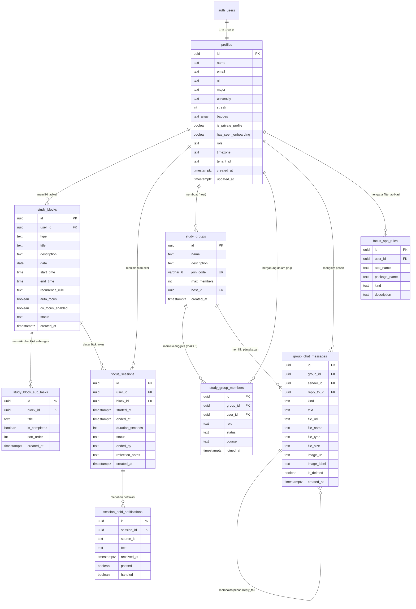

# Dokumentasi Logika Mock & Cetak Biru Database Supabase
**Aplikasi:** Smart Focus Akademik (SmartLearningApp)  
**Tujuan Dokumen:** Panduan komprehensif pemetaan logika *mock data* (Zustand + LocalStorage) ke dalam arsitektur database relasional PostgreSQL di Supabase.

---

## 1. Ringkasan Eksekutif & Alur Transisi

Saat ini aplikasi Smart Focus Akademik berjalan menggunakan arsitektur **Frontend-First Mock** yang mengombinasikan *in-memory state* (Zustand) dan persistensi peramban (*LocalStorage*). 

Untuk beralih ke backend produksi **Supabase (PostgreSQL + Auth + Realtime + Storage)**, seluruh aturan bisnis (*business rules*), relasi data, pembatasan (*constraints*), dan mutasi state yang selama ini ditangani oleh fungsi frontend perlu dipetakan ke dalam tabel database, integritas referensial (*foreign keys*), pemicu (*database triggers*), dan kebijakan keamanan baris (*Row Level Security / RLS*).

---

## 2. Diagram Relasi Entitas (ERD)

Berikut adalah diagram relasi entitas Supabase yang merepresentasikan seluruh alur data dari mock data saat ini:



---

## 3. Bedah Logika Mock per Fitur & Aturan Bisnis

### 3.1. Autentikasi, Profil Pengguna, Gamifikasi & Privasi
*File Acuan: `src/store/authStore.ts`, `src/types/index.ts`, `src/pages/Settings.tsx`*

* **Sumber Identitas:** Terhubung dengan `auth.users` Supabase. Di sisi publik dibuat tabel `profiles`.
* **Atribut Data:**
  * `streak`: Bilangan bulat penanda konsistensi hari belajar (Default mock: `3`).
  * `badges`: Kumpulan lencana pencapaian (Default: `['Fokus Master', 'Awal yang Baik']`).
  * `is_private_profile`: Boolean kontrol privasi (Default: `false`).
  * `has_seen_onboarding`: Boolean penanda apakah pengguna sudah melihat pop-up onboarding saat pertama login (Default: `false`).
* **Logika Mutasi:**
  * `updateProfile(data)`: Mengubah `name`, `nim`, `major`, `university`.
  * `togglePrivacy(isPrivate)`: Mengubah `is_private_profile`. Jika bernilai `true`, data nama pengguna disembunyikan / disamarkan dari Leaderboard Kampus publik.
  * `setHasSeenOnboarding()`: Mengubah status modal selamat datang agar tidak muncul lagi di masa mendatang.

---

### 3.2. Jadwal & Blok Belajar (Study Blocks) + Sub-Tasks Checklist
*File Acuan: `src/store/studyStore.ts`, `src/data/mockData.ts`, `src/pages/StudyBlocks.tsx`*

* **Entitas Utama:**
  * `study_blocks`: Mewakili satu blok jadwal belajar mahasiswa.
  * `study_block_sub_tasks`: Item checklist pekerjaan di dalam satu blok belajar.
* **Kategori Tipe Blok (`type`):**
  * `'Jadwal kuliah'`, `'Belajar mandiri'`, `'Kerja kelompok'`, `'Persiapan ujian'`.
* **Logika Bisnis:**
  * `auto_focus`: Menandai apakah mode fokus otomatis aktif saat waktu mulai tiba.
  * `co_focus_enabled`: Menandai apakah sesi belajar ini otomatis menghubungkan pengguna ke ruang belajar bersama (*Co-Focus*).
  * `status`: `'scheduled'`, `'active'`, atau `'completed'`.
  * `toggleSubTask(blockId, taskId)`: Membalik nilai boolean `is_completed`. Di UI, sub-task yang selesai diberi tanda coret (`line-through`) dan warna abu-abu.
* **Relasi:** 1 `study_block` memiliki 0 hingga banyak `study_block_sub_tasks` (`ON DELETE CASCADE`).

---

### 3.3. Sesi Fokus, Timer, Notifikasi Ditahan & Jurnal Refleksi
*File Acuan: `src/store/sessionStore.ts`, `src/pages/FocusMode.tsx`, `src/pages/SessionSummary.tsx`*

* **Siklus Hidup Status Sesi (`status`):**
  * `idle` $\rightarrow$ `running` $\leftrightarrow$ `paused` $\rightarrow$ `completed`.
* **Kalkulasi Durasi:**
  * Durasi target dihitung dari selisih `end_time - start_time` (dalam detik).
  * Durasi aktual = `plannedDuration - remainingTime`.
* **Notifikasi yang Ditahan (*Held Notifications*):**
  * Selama sesi berjalan (`status = running`), aplikasi menahan notifikasi dari aplikasi pengganggu (WhatsApp, Instagram, Telegram, dll.).
  * Notifikasi yang masuk disimpan sementara dengan properti `session_id`, `source_id`, `text`, `received_at`, `passed: false`, `handled: boolean`.
* **Jurnal Refleksi Pasca Sesi:**
  * Saat sesi berakhir, pengguna diarahkan ke halaman `/session-summary` untuk mengisi refleksi singkat (`reflection_notes`). Data ini disimpan untuk melengkapi rekam jejak sesi fokus.

---

### 3.4. Co-Focus: Ruang Belajar Virtual Berbasis Kode Unik
*File Acuan: `src/store/groupStore.ts`, `src/pages/CoFocus.tsx`*

* **Aturan Kode Ruangan (*Join Code*):**
  * Terdiri dari **6 karakter unik** (kombinasi huruf kapital dan angka tanpa karakter ambigu, misal `ABCDEFGHJKLMNPQRSTUVWXYZ23456789`).
  * Bersifat unik di tingkat sistem (`UNIQUE` constraint).
* **Aturan Kapasitas Anggota (Maks 6 Orang):**
  * Setiap ruang belajar dibatasi maksimal **6 anggota** (`max_members: 6`).
  * Saat calon peserta memanggil `joinGroup(code)`:
    1. Cari ruang dengan kode tersebut. Jika tidak ditemukan $\rightarrow$ kembalikan error *"Kode ruangan tidak valid"*.
    2. Hitung jumlah anggota saat ini. Jika anggota $\ge 6$ $\rightarrow$ kembalikan error *"Maaf, ruang belajar sudah penuh (Maks 6 orang)"*.
    3. Jika pengguna sudah terdaftar di ruang tersebut, arahkan masuk tanpa menambah duplikasi anggota.
    4. Jika lolos validasi, tambahkan user sebagai anggota baru (`role: 'member'`).
* **Pembuatan Ruangan Baru (`createGroup(name)`):**
  * Menghasilkan 6 karakter acak unik.
  * Pengguna pembuat otomatis menjadi `host` (`isHost: true`, `role: 'owner'`).
* **Status Keaktifan Anggota:**
  * Tiap anggota memiliki status real-time: `'fokus'` atau `'istirahat'`.

---

### 3.5. Manajemen Chat di Ruang Belajar (Balas & Hapus Pesan)
*File Acuan: `src/components/group/StudyGroupRoom.tsx`, `src/data/mockData.ts`*

* **Jenis Pesan Multimodal (`kind`):**
  * `'text'`: Pesan teks biasa.
  * `'image'`: Gambar cuplikan layar atau catatan dengan `image_url` dan `image_label`.
  * `'document'`: Dokumen pendukung dengan `file_name`, `file_type` (`PDF`, `Word`, `JPG`), `file_size`, dan `file_url`.
* **Fitur Balas Pesan (*Reply Message*):**
  * Setiap pesan memiliki field opsional `reply_to_id` yang mereferensikan `id` pesan lain dalam grup yang sama (*Self-referencing Foreign Key*).
  * Di UI, jika `reply_to_id` terisi, kutipan pesan asal dirender di bagian atas bubble obrolan.
* **Fitur Hapus Pesan (*Soft Delete*):**
  * Pengguna hanya diizinkan menghapus pesan miliknya sendiri (`sender_id === auth.uid()`).
  * Pesan **tidak dihapus secara fisik** dari database, melainkan ditandai `is_deleted = true`.
  * Di UI, jika `is_deleted = true`, teks pesan ditampilkan miring (*italic*) dengan bunyi *"Pesan ini telah dihapus"*, serta tombol aksi balas/hapus dinonaktifkan.

---

### 3.6. Aturan Filter Aplikasi & Notifikasi
*File Acuan: `src/data/mockData.ts` (`mockFocusApps`), Android Native Bridge*

* **Kategori Aplikasi:**
  * `'allowed'` (Aplikasi diizinkan): Dokumen, referensi kuliah (Word, Docs, Canva).
  * `'blocked'` (Aplikasi diblokir): Media sosial, hiburan (Instagram, TikTok, WhatsApp).
* Mahasiswa dapat mengelola daftar aplikasi ini sesuai kebutuhan belajarnya.

---

## 4. Skrip DDL PostgreSQL Supabase Lengkap

Jalankan skrip SQL berikut di **Supabase SQL Editor** untuk membangun seluruh tabel, relasi, constraint, trigger, dan view:

```sql
-- ====================================================================
-- SKEMA DATABASE SMART FOCUS AKADEMIK (SUPABASE POSTGRESQL)
-- ====================================================================

-- 1. EXTENSIONS
create extension if not exists "uuid-ossp";

-- ====================================================================
-- 2. TABEL PROFIL PENGGUNA (Terkoneksi dengan auth.users)
-- ====================================================================
create table if not exists public.profiles (
  id uuid primary key references auth.users(id) on delete cascade,
  name text not null,
  email text not null,
  nim text default '',
  major text default '',
  university text default '',
  streak integer not null default 0,
  badges text[] not null default array['Awal yang Baik']::text[],
  is_private_profile boolean not null default false,
  has_seen_onboarding boolean not null default false,
  role text not null default 'mahasiswa' check (role in ('mahasiswa', 'dosen', 'admin')),
  timezone text not null default 'Asia/Jakarta',
  tenant_id text default 'default',
  created_at timestamptz not null default now(),
  updated_at timestamptz not null default now()
);

-- Trigger otomatis saat user mendaftar di Supabase Auth
create or replace function public.handle_new_user()
returns trigger as $$
begin
  insert into public.profiles (id, email, name, nim, major, university, streak, badges, is_private_profile, has_seen_onboarding)
  values (
    new.id,
    new.email,
    coalesce(new.raw_user_meta_data->>'name', split_part(new.email, '@', 1)),
    coalesce(new.raw_user_meta_data->>'nim', ''),
    coalesce(new.raw_user_meta_data->>'major', ''),
    coalesce(new.raw_user_meta_data->>'university', 'Universitas Indonesia'),
    3,
    array['Fokus Master', 'Awal yang Baik'],
    false,
    false
  );
  return new;
end;
$$ language plpgsql security definer;

drop trigger if exists on_auth_user_created on auth.users;
create trigger on_auth_user_created
  after insert on auth.users
  for each row execute function public.handle_new_user();


-- ====================================================================
-- 3. TABEL JADWAL & BLOK BELAJAR (STUDY BLOCKS)
-- ====================================================================
create table if not exists public.study_blocks (
  id uuid primary key default gen_random_uuid(),
  user_id uuid not null references public.profiles(id) on delete cascade,
  type text not null check (type in ('Jadwal kuliah', 'Belajar mandiri', 'Kerja kelompok', 'Persiapan ujian')),
  title text not null,
  description text not null default '',
  date date not null,
  start_time time not null,
  end_time time not null,
  recurrence_rule text,
  auto_focus boolean not null default false,
  co_focus_enabled boolean not null default false,
  status text not null default 'scheduled' check (status in ('scheduled', 'active', 'completed')),
  created_at timestamptz not null default now(),
  updated_at timestamptz not null default now()
);

create index if not exists idx_study_blocks_user_date on public.study_blocks (user_id, date);


-- ====================================================================
-- 4. TABEL SUB-TASKS (CHECKLIST DI DALAM BLOK BELAJAR)
-- ====================================================================
create table if not exists public.study_block_sub_tasks (
  id uuid primary key default gen_random_uuid(),
  block_id uuid not null references public.study_blocks(id) on delete cascade,
  title text not null,
  is_completed boolean not null default false,
  sort_order integer not null default 0,
  created_at timestamptz not null default now()
);

create index if not exists idx_sub_tasks_block on public.study_block_sub_tasks (block_id);


-- ====================================================================
-- 5. TABEL SESI FOKUS & JURNAL REFLEKSI
-- ====================================================================
create table if not exists public.focus_sessions (
  id uuid primary key default gen_random_uuid(),
  user_id uuid not null references public.profiles(id) on delete cascade,
  block_id uuid references public.study_blocks(id) on delete set null,
  started_at timestamptz not null default now(),
  ended_at timestamptz,
  duration_seconds integer not null default 0,
  status text not null default 'active' check (status in ('active', 'paused', 'completed')),
  ended_by text check (ended_by in ('user', 'system')),
  reflection_notes text,
  created_at timestamptz not null default now()
);

create index if not exists idx_focus_sessions_user on public.focus_sessions (user_id, started_at desc);


-- ====================================================================
-- 6. TABEL NOTIFIKASI YANG DITAHAN (HELD NOTIFICATIONS)
-- ====================================================================
create table if not exists public.session_held_notifications (
  id uuid primary key default gen_random_uuid(),
  session_id uuid not null references public.focus_sessions(id) on delete cascade,
  source_id text not null,
  text text not null,
  received_at timestamptz not null default now(),
  passed boolean not null default false,
  handled boolean not null default false
);

create index if not exists idx_held_notifications_session on public.session_held_notifications (session_id);


-- ====================================================================
-- 7. TABEL RUANG CO-FOCUS (STUDY GROUPS)
-- ====================================================================
create table if not exists public.study_groups (
  id uuid primary key default gen_random_uuid(),
  name text not null,
  description text default '',
  join_code varchar(6) not null unique,
  max_members integer not null default 6 check (max_members <= 6),
  host_id uuid not null references public.profiles(id) on delete cascade,
  created_at timestamptz not null default now()
);

create index if not exists idx_study_groups_code on public.study_groups (upper(join_code));


-- ====================================================================
-- 8. TABEL ANGGOTA RUANG BELAJAR (STUDY GROUP MEMBERS)
-- ====================================================================
create table if not exists public.study_group_members (
  id uuid primary key default gen_random_uuid(),
  group_id uuid not null references public.study_groups(id) on delete cascade,
  user_id uuid not null references public.profiles(id) on delete cascade,
  role text not null default 'member' check (role in ('owner', 'member')),
  status text not null default 'fokus' check (status in ('fokus', 'istirahat', 'tersedia')),
  course text default '',
  joined_at timestamptz not null default now(),
  constraint uq_group_member unique (group_id, user_id)
);

create index if not exists idx_group_members_group on public.study_group_members (group_id);

-- TRIGGER ATURAN: MAKSIMAL 6 ORANG PER RUANG BELAJAR
create or replace function public.check_max_group_members()
returns trigger as $$
declare
  member_count integer;
  max_allowed integer;
begin
  select count(*), coalesce(max(sg.max_members), 6)
  into member_count, max_allowed
  from public.study_group_members sgm
  join public.study_groups sg on sg.id = NEW.group_id
  where sgm.group_id = NEW.group_id;

  if member_count >= max_allowed then
    raise exception 'Maaf, ruang belajar sudah penuh (Maks % orang)', max_allowed;
  end if;

  return NEW;
end;
$$ language plpgsql;

drop trigger if exists trg_enforce_max_members on public.study_group_members;
create trigger trg_enforce_max_members
  before insert on public.study_group_members
  for each row execute function public.check_max_group_members();


-- ====================================================================
-- 9. TABEL CHAT RUANG BELAJAR (DENGAN BALAS & SOFT DELETE)
-- ====================================================================
create table if not exists public.group_chat_messages (
  id uuid primary key default gen_random_uuid(),
  group_id uuid not null references public.study_groups(id) on delete cascade,
  sender_id uuid not null references public.profiles(id) on delete cascade,
  reply_to_id uuid references public.group_chat_messages(id) on delete set null,
  kind text not null default 'text' check (kind in ('text', 'image', 'document')),
  text text,
  file_url text,
  file_name text,
  file_type text check (file_type in ('PDF', 'Word', 'JPG', null)),
  file_size text,
  image_url text,
  image_label text,
  is_deleted boolean not null default false,
  created_at timestamptz not null default now()
);

create index if not exists idx_group_chat_group_time on public.group_chat_messages (group_id, created_at asc);


-- ====================================================================
-- 10. TABEL ATURAN APLIKASI FOKUS (WHITELIST & BLOCKLIST)
-- ====================================================================
create table if not exists public.focus_app_rules (
  id uuid primary key default gen_random_uuid(),
  user_id uuid not null references public.profiles(id) on delete cascade,
  app_name text not null,
  package_name text default '',
  kind text not null check (kind in ('allowed', 'blocked')),
  description text default '',
  created_at timestamptz not null default now()
);

create index if not exists idx_focus_apps_user on public.focus_app_rules (user_id);
```

---

## 5. Kebijakan Keamanan Row Level Security (RLS)

Setiap tabel di Supabase harus dilindungi oleh RLS agar mahasiswa hanya dapat mengakses data miliknya sendiri atau data grup yang diikutinya:

```sql
-- Aktifkan RLS di seluruh tabel
alter table public.profiles enable row level security;
alter table public.study_blocks enable row level security;
alter table public.study_block_sub_tasks enable row level security;
alter table public.focus_sessions enable row level security;
alter table public.session_held_notifications enable row level security;
alter table public.study_groups enable row level security;
alter table public.study_group_members enable row level security;
alter table public.group_chat_messages enable row level security;
alter table public.focus_app_rules enable row level security;

-- PROFILES
create policy "Profil dapat dibaca oleh pemilik atau pengguna terautentikasi (jika publik)"
  on public.profiles for select
  using (auth.uid() = id or is_private_profile = false);

create policy "Profil hanya dapat diubah oleh pemiliknya"
  on public.profiles for update
  using (auth.uid() = id);

-- STUDY BLOCKS & SUB-TASKS
create policy "Pengguna mengelola blok belajarnya sendiri"
  on public.study_blocks for all
  using (auth.uid() = user_id);

create policy "Pengguna mengelola checklist sub-tugasnya sendiri"
  on public.study_block_sub_tasks for all
  using (
    exists (
      select 1 from public.study_blocks sb
      where sb.id = study_block_sub_tasks.block_id and sb.user_id = auth.uid()
    )
  );

-- FOCUS SESSIONS & HELD NOTIFICATIONS
create policy "Pengguna mengelola sesi fokusnya sendiri"
  on public.focus_sessions for all
  using (auth.uid() = user_id);

create policy "Pengguna mengelola notifikasi yang ditahan"
  on public.session_held_notifications for all
  using (
    exists (
      select 1 from public.focus_sessions fs
      where fs.id = session_held_notifications.session_id and fs.user_id = auth.uid()
    )
  );

-- STUDY GROUPS & MEMBERS
create policy "Ruang belajar dapat dicari/dibaca oleh user yang terautentikasi"
  on public.study_groups for select
  using (auth.role() = 'authenticated');

create policy "User dapat membuat ruang belajar baru"
  on public.study_groups for insert
  with check (auth.uid() = host_id);

create policy "Anggota ruang dapat membaca daftar anggota grup"
  on public.study_group_members for select
  using (
    exists (
      select 1 from public.study_group_members sgm
      where sgm.group_id = study_group_members.group_id and sgm.user_id = auth.uid()
    )
  );

create policy "User dapat bergabung ke dalam ruang belajar"
  on public.study_group_members for insert
  with check (auth.uid() = user_id);

create policy "User dapat keluar atau mengubah status fokusnya di ruang"
  on public.study_group_members for update
  using (auth.uid() = user_id);

create policy "User dapat meninggalkan ruang belajar"
  on public.study_group_members for delete
  using (auth.uid() = user_id);

-- GROUP CHAT MESSAGES
create policy "Hanya anggota grup yang dapat membaca chat"
  on public.group_chat_messages for select
  using (
    exists (
      select 1 from public.study_group_members sgm
      where sgm.group_id = group_chat_messages.group_id and sgm.user_id = auth.uid()
    )
  );

create policy "Anggota grup dapat mengirim chat"
  on public.group_chat_messages for insert
  with check (
    auth.uid() = sender_id and
    exists (
      select 1 from public.study_group_members sgm
      where sgm.group_id = group_chat_messages.group_id and sgm.user_id = auth.uid()
    )
  );

create policy "Pengirim dapat memperbarui/menghapus pesannya sendiri (soft delete)"
  on public.group_chat_messages for update
  using (auth.uid() = sender_id);
```

---

## 6. Fitur Realtime & Storage di Supabase

### 6.1. Supabase Realtime (Live Sync)
Aktifkan publikasi Realtime agar interaksi antar-mahasiswa berjalan instan tanpa perlu me-refresh halaman:
1. `study_group_members`: Sinkronisasi status fokus/istirahat rekan belajar secara langsung.
2. `group_chat_messages`: Pengiriman pesan, balasan pesan, dan pembaruan pesan yang dihapus secara langsung ke seluruh anggota ruang belajar.

```sql
-- Tambahkan tabel ke publikasi realtime Supabase
alter publication supabase_realtime add table public.study_group_members;
alter publication supabase_realtime add table public.group_chat_messages;
```

### 6.2. Supabase Storage (Berkas & Lampiran Chat)
Buat Bucket penyimpanan di Supabase Storage:
* `chat-attachments` (Tipe: Private/Restricted untuk anggota grup)
  * Folder: `/documents/` (PDF, Word)
  * Folder: `/images/` (JPG, PNG)
* `avatars` (Tipe: Public)
  * Folder: `/user-profiles/`

---

## 7. Langkah Transisi Teknis (Dari Mock ke Supabase Client)

| Komponen Mock | Target Supabase API | Catatan Implementasi |
| :--- | :--- | :--- |
| `useAuthStore` | `supabase.auth.signInWithPassword` & `supabase.from('profiles')` | Mengganti *initial dummy user* dengan sesi aktif `auth.users` dan trigger profil. |
| `useStudyStore` | `supabase.from('study_blocks').select('*, study_block_sub_tasks(*)')` | Mengubah *in-memory array* menjadi query relasional Supabase. |
| `useStudyStore.toggleSubTask` | `supabase.from('study_block_sub_tasks').update({ is_completed }).eq('id', taskId)` | Update langsung ke item checklist tunggal. |
| `useGroupStore.createGroup` | `supabase.from('study_groups').insert(...)` | Kode 6 karakter digenerate atau divalidasi via fungsi PL/pgSQL. |
| `useGroupStore.joinGroup` | `supabase.from('study_group_members').insert(...)` | Validasi kuota 6 orang diproteksi langsung oleh database trigger `check_max_group_members`. |
| `StudyGroupRoom` Chat | `supabase.from('group_chat_messages')` + channel `postgres_changes` | Chat bubble terhubung ke Supabase Realtime untuk menerima siaran pesan masuk dan status `is_deleted`. |

---

*Dokumen ini dapat digunakan sebagai referensi utama saat melakukan migrasi backend Supabase tanpa merusak desain UI Tailwind maupun flow aplikasi yang sudah berjalan.*

