# Panduan Arsitektur: Pengertian Expo & Mengapa Tampilan di Expo Go Berbeda

Dokumen ini menjelaskan secara menyeluruh tentang **peran Expo** di dalam proyek SmartLearning, **arsitektur dual-aplikasi** di repositori ini, serta alasan teknis **mengapa tampilan saat dibuka di Expo Go berbeda dengan tampilan aplikasi Web di browser**.

---

## 1. Ringkasan Singkat: Mengapa Tampilannya Berbeda?

Jika Anda membuka aplikasi di browser komputer, Anda melihat antarmuka **Smart Focus Akademik** bertema klasik bersih (*white, navy `#1D3668`, crimson `#BE2257`*), lengkap dengan login Supabase, jadwal belajar, grafik laporan analitik, dan Co-Focus Realtime.

Namun, saat Anda membuka **Expo Go** di ponsel (Android/iOS), tampilannya berwarna gelap (*dark theme*) dengan tab *Fokus, Jadwal, Kelompok, Evaluasi* dan data mock.

> [!IMPORTANT]
> **Penyebab Utama:**  
> Repositori ini memiliki **dua aplikasi yang berbeda**:
> 1. **Aplikasi Web Utama** (berada di folder `src/`) berbasis **React 19 + Vite + Tailwind CSS + Supabase**.
> 2. **Aplikasi Mobile Prototype** (berada di folder `mobile/`) berbasis **React Native + Expo SDK 58**.
>
> Saat Anda menjalankan Expo (`npx expo start`), yang dimuat dan dijalankan di Expo Go adalah **`mobile/App.tsx`**, **bukan** file `src/App.tsx` milik web.

---

## 2. Peta Arsitektur Proyek (Dual-Architecture)

```mermaid
flowchart TD
    Repo["SmartLearningApp (Repository Root)"]

    subgraph WebApp ["1. APLIKASI WEB UTAMA (src/)"]
        WebEntry["src/App.tsx & main.tsx"]
        WebEngine["Vite 8 + React 19 (React-DOM)"]
        WebUI["Tailwind CSS + Lucide Icons + Recharts"]
        WebBackend["Supabase Cloud BaaS (Auth, DB, Realtime)"]
        WebBrowser["Dijalankan via Browser: Chrome, Edge, Safari"]
        WebEntry --> WebEngine --> WebUI --> WebBackend --> WebBrowser
    end

    subgraph MobileApp ["2. APLIKASI MOBILE COMPANION (mobile/)"]
        MobileEntry["mobile/App.tsx"]
        MobileEngine["Expo SDK 58 + React Native 0.88"]
        MobileUI["React Native Native Components (View, Text, Pressable)"]
        MobileNative["Custom Kotlin Modules (App Lock & Notification Listener)"]
        MobileClient["Dijalankan via: Expo Go / Standalone APK"]
        MobileEntry --> MobileEngine --> MobileUI --> MobileNative --> MobileClient
    end

    Repo --> WebApp
    Repo --> MobileApp
```



---

## 3. Tabel Perbandingan: Web App vs Mobile App

| Komponen | Aplikasi Web (`src/`) | Aplikasi Mobile (`mobile/`) |
| :--- | :--- | :--- |
| **Lokasi Kode** | Folder `src/` & `index.html` | Folder `mobile/` & `mobile/App.tsx` |
| **Teknologi Utama** | React 19 + Vite | React Native 0.88 + Expo SDK 58 |
| **Elemen Tampilan** | Tag HTML (`<div>`, `<button>`, `<h1>`, `<p>`) | Komponen Native (`<View>`, `<Text>`, `<Pressable>`) |
| **Sistem Desain & Tema** | Tailwind CSS (Tema Bersih: Putih, Navy, Crimson) | StyleSheet React Native (Tema Gelap: `#080D18`, `#101827`) |
| **Penyimpanan / Database** | **Supabase Cloud** (Database PostgreSQL, Auth, Realtime) | **Mock Data Lokal** (`src/data/mockData.ts`) |
| **Fitur Unggulan** | Forum Co-Focus Realtime, Analitik Recharts, Kalender Jadwal | Prototype Kunci Aplikasi Android & Tangkap Notifikasi |
| **Cara Menjalankan** | `npm run dev` (buka di browser: `localhost:5173`) | `cd mobile && npx expo start` (buka via Expo Go) |

---

## 4. Tiga Alasan Teknis Mengapa Expo Go Tidak Menampilkan Web App

### Alasan 1: Perbedaan Mendasar React DOM vs React Native
- Aplikasi web Anda menggunakan **React DOM**, yaitu elemen web HTML standar (`<div>`, `<input>`, `<button>`, tabel, flex Tailwind) yang hanya dipahami oleh mesin peramban (*browser engine* seperti Chromium atau WebKit).
- **Expo Go** adalah aplikasi mobile berbasis **React Native**. React Native tidak memiliki browser internal untuk merender tag HTML atau class Tailwind CSS. React Native harus menggunakan komponen antarmuka bawaan sistem operasi mobile (`UIView` di iOS dan `android.view.View` di Android).
- Karena itu, kode React Web (`src/`) tidak dapat langsung diproses oleh Expo tanpa perantara WebView.

### Alasan 2: `mobile/App.tsx` Dibuat Khusus Sebagai "Companion App"
- Folder `mobile/` awalnya dirancang sebagai aplikasi pendamping mobile khusus Android untuk menguji fitur tingkat sistem:
  1. **Accessibility Service** (`FocusAccessibilityService.kt`): Mengunci aplikasi distraksi seperti Instagram, TikTok, dan WhatsApp saat sesi belajar aktif.
  2. **Notification Listener Service** (`FocusNotificationListener.kt`): Menahan notifikasi yang masuk selama belajar dan menyimpannya di perangkat untuk direfleksikan nanti.
- Antarmuka di `mobile/App.tsx` memang sengaja dibuat terpisah dengan tampilan panel gelap minimalis untuk mengontrol kedua layanan sistem tersebut.

### Alasan 3: Keterbatasan Aplikasi Expo Go terhadap Modul Native Kotlin
- Aplikasi **Expo Go** yang diunduh dari Google Play Store atau App Store adalah aplikasi biner yang sudah dikompilasi sebelumnya (*pre-built*).
- Expo Go hanya berisi API standar Expo. Expo Go **tidak memiliki kode native kustom Kotlin** yang ada di folder `mobile/modules/focus-enforcement/`.
- Oleh karena itu, saat dibuka di Expo Go, tombol izin sistem Android berada dalam status nonaktif (*disabled*) karena modul native tersebut hanya dapat berjalan jika dibuild menjadi file APK native menggunakan **EAS Build** (`eas build -p android --profile preview`).

---

## 5. Solusi & Rekomendasi: Bagaimana Cara Melihat Tampilan Web Asli di HP?

Tergantung pada kebutuhan Anda, berikut adalah 3 opsi terbaik:

### Opsi A (Paling Cepat & Direkomendasikan): Buka Web App Langsung di Browser HP
Jika tujuan Anda adalah **menguji antarmuka Smart Focus yang sesungguhnya** (dengan login Supabase, jadwal, forum Co-Focus, dan grafik laporan) langsung di layar HP Anda:

1. Pastikan laptop dan HP terhubung ke **Wi-Fi yang sama**.
2. Di terminal laptop, jalankan web app dengan flag host:
   ```bash
   npm run dev -- --host
   ```
3. Di terminal akan muncul alamat IP lokal, contoh:
   ```text
   ➜  Local:   http://localhost:5173/
   ➜  Network: http://172.16.0.23:5173/
   ```
4. Buka browser di HP Anda (Chrome di Android atau Safari di iPhone), lalu ketik alamat **`http://172.16.0.23:5173`** (sesuai IP Network yang tampil).
5. **Hasil:** Anda akan melihat tampilan web Smart Focus yang 100% lengkap, rapi, dan responsif di layar ponsel Anda!

---

### Opsi B: Membungkus Web App ke Dalam Expo Menggunakan WebView
Jika Anda ingin **aplikasi Expo di HP menampilkan tampilan Web yang lengkap**, kita bisa memanfaatkan komponen `react-native-webview` di dalam `mobile/App.tsx`:

1. Aplikasi mobile akan memuat URL Web App Anda ke dalam WebView satu layar penuh (*fullscreen*).
2. Tampilan di Expo Go akan langsung berubah menjadi tampilan Smart Focus klasik (putih/navy/crimson) lengkap dengan seluruh fungsionalitas Supabase.
3. Sekaligus tetap mempertahankan jembatan (*bridge*) ke layanan native Android jika diperlukan.

---

### Opsi C: Menyelaraskan Desain React Native (`mobile/`) Menjadi Identik dengan Web
Jika Anda ingin membangun aplikasi **Pure Native** di Expo (tanpa WebView):
1. Mengganti tema gelap di `mobile/App.tsx` dengan palet warna resmi: Kanvas `#F3F4FA`, Primary Navy `#1D3668`, dan Crimson `#BE2257`.
2. Menghubungkan state mobile langsung ke client Supabase (`@supabase/supabase-js`) sehingga data tidak lagi menggunakan mock data lokal, melainkan data riil akun Anda.

---

## 6. Kesimpulan

- **Expo bukan pengganti Vite/Web**, melainkan platform untuk membangun aplikasi mobile native.
- **Expo Go saat ini menampilkan `mobile/App.tsx`**, yaitu prototipe terpisah bertema gelap dengan mock data.
- **Tampilan web asli Anda tetap aman dan utuh di folder `src/`**, dan dapat langsung dibuka di ponsel mana pun melalui browser ponsel dengan menjalankan `npm run dev -- --host`.

